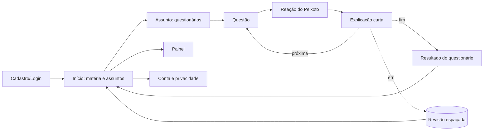

# Gabaritu: escopo do MVP

Projeto open source, feito por diversão, sem fins comerciais. Documento vivo: atualize ao mudar o escopo.

**O Gabaritu é uma plataforma de estudo, não um jogo.** O Candy Crush é referência só da animação (explosões, brilhos, partículas, gosma, sons, reações do Peixoto). Não há mapa, estrelas, combo, vidas nem "fim de fase". O progresso é medido só pelo desempenho.

**Requisito transversal: tom lúdico em toda a plataforma.** Não é só a tela de questão: cadastro, login, recuperação de senha, painel, conta, página de privacidade, e-mails, telas de erro e estados vazios têm o Peixoto, visual cartoon e texto com humor. **Regra de ouro: a piada nunca esconde a informação.** Em erro de senha, privacidade, exclusão de conta e consentimento, a frase clara vem primeiro e a piada depois. A página de privacidade é divertida, mas completa e verdadeira. A zoeira mira a situação, nunca a pessoa, e vale o teto por idade também fora das questões.

**Requisito de layout: a tela de questão não tem scroll vertical (decisão do dono).** Enunciado, alternativas, reação do Peixoto, "Por quê?" e o botão de seguir cabem na altura da tela (celular a partir de 360×640 e desktop a partir de 1366×768), pro aluno nunca perder a piada. Na reação, as alternativas não escolhidas encolhem pra dar lugar à explicação. A tela de resultado segue a mesma regra. Teste automático confere a altura nessas viewports.

**Regra fixa do catálogo (decidida pelo dono, vale em todos os níveis, inclusive Sem filtro):** nenhuma fala usa doença, deficiência, transtorno (físico ou mental), corpo, aparência, religião ou origem como xingamento ou comparação. Exemplo proibido: "você tem demência". Alternativa: "essa resposta tem memória de peixe... e olha que o peixe aqui sou eu". O Sem filtro é dramático e exagerado, mas zoa a resposta ou a ação ("leu o enunciado ou só sentiu a vibe?"), nunca quem respondeu. A revisão de pacote reprova qualquer variação que quebre a regra.

**Requisito de arquitetura: texto com meme nunca fica fixo no código.** Todo texto de interface baseado em meme ou referência atual vive num **catálogo de falas**: cada chave tem várias variações, e cada variação tem nível de zoeira, idade mínima e data de validade. O app sorteia, em tempo de execução, uma variação válida para o nível e a idade do aluno. Cada chave tem uma **variação atemporal de reserva** (sem validade) usada quando todas as outras vencem ou não servem ao aluno. O catálogo é atualizado por **pacote**: manual e revisado pelo dono no MVP; pela GitHub Action semanal na fase 2. **Exceção:** os rótulos essenciais (botões de senha, exclusão e consentimento) têm texto fixo e claro; o meme fica só no complemento. **Só referência em texto**: nada de imagem, vídeo ou áudio de meme, e nada que exponha pessoa real.

## 1. Objetivo e critério de "deu certo"

**Objetivo:** provar que estudar matemática do ENEM com o Peixoto (baiacu que comemora acerto e zoa o erro, sempre explicando depois) é divertido o bastante pra adolescente voltar, e que o acompanhamento por tipo de erro ajuda de verdade.

**Hipóteses a validar:**
1. A zoeira com explicação curta engaja sem constranger.
2. A etiqueta de erro por alternativa gera um diagnóstico que o aluno acha útil.
3. A nota por assunto e a revisão espaçada dão ao aluno motivo claro para voltar.

**Deu certo se (metas iniciais, o dono ajusta):**
- Um grupo piloto de 10 a 20 adolescentes completa o cadastro e ao menos 3 questionários cada, sem ajuda.
- Pelo menos metade volta em 2 dias diferentes na semana seguinte.
- Pergunta de 1 clique após o questionário ("a zoeira foi legal?"): 80% ou mais "legal"; qualquer relato de "me senti zoado" é lido um a um.
- Pelo menos 1 aluno em 2 abre o diagnóstico por tipo de erro e responde "fez sentido".
- Zero incidente de segurança ou privacidade; exclusão de conta funcionando.

Sem analytics de terceiros: a métrica vem do próprio banco e do formulário de 1 clique.

## 2. Escopo (MoSCoW)

**Must**
- Cadastro/login/recuperação de senha por e-mail; idade mínima 13; apagar conta de verdade; página de privacidade curta.
- Organização matéria > assunto > questionário, com a matéria Matemática (ENEM).
- 50 a 100 questões A–E, gabarito, etiqueta de erro por alternativa errada, explicação curta. Licença CC-BY-SA, com fonte registrada por questão.
- Catálogo de falas (arquitetura acima): chaves, variações com nível/idade/validade, variação atemporal de reserva por chave, sorteio em tempo de execução, importação de pacote revisado e comando que lista o que vence em breve ou já venceu.
- Peixoto: fala em balão por resposta (acerto/erro) e explicação depois; todas as falas vêm do catálogo, pré-geradas e revisadas.
- Níveis Fofo / Sarcástico / Sem filtro com teto por idade (regras definidas pelo dono); freio automático após erros seguidos.
- Painel: nota por assunto (escala estilo ENEM, estimativa), evolução no tempo, diagnóstico por tipo de erro.
- Revisão espaçada das erradas.
- Tom lúdico transversal (ver topo): textos e visual do Peixoto em todas as telas, e-mails, erros (404/500/offline) e estados vazios, todos via catálogo, com a regra "frase clara primeiro, piada depois" nos pontos críticos. Os rótulos essenciais ficam fixos.
- Reduzir movimento, pular animação, opção de som; animações abaixo de 1s.
- Revisão `NEZUKO` antes de ir ao ar.

**Should**
- Animações de explosão, brilho e partículas completas, gosma no erro e som de acerto com variação (versão enxuta no Must, polimento aqui).
- Voz em "peixês" (bipes) com várias entonações.
- Simulado (questões misturadas de vários assuntos, nota geral estimada).
- Gráfico de evolução; botão "reportar fala/questão"; exportar os dados do aluno (JSON).

**Could**
- Banco de falas "que não envelhecem" maior; variações por assunto.
- Modo escuro; PWA instalável.

**Won't (no MVP)**
- Qualquer mecânica de jogo: mapa de fases, estrelas, combo/multiplicador, vidas, ranking.
- Professor, pais, turmas; IA em tempo de uso.
- Fase 2: GitHub Action semanal de memes com PR revisado (validade ~6 semanas).
- Outras matérias, redação, pagamento, app nativo, login social.

## 3. Telas e fluxos

| Tela | Conteúdo e regras |
|---|---|
| Cadastro | Apelido, ano de nascimento, série/etapa, e-mail, senha. Ano que dá menos de 13 anos: bloqueia com mensagem simples e não guarda nada. Aviso curto de privacidade com link. Orientação para apelido sem dados reais. |
| Login | E-mail + senha, limite de tentativas. |
| Recuperação | Pede e-mail, resposta idêntica exista ou não a conta, link com validade curta e uso único, define nova senha. |
| Início / matéria | Lista de assuntos da matéria, com a nota estimada de cada um e o atalho "Revisão do dia". |
| Assunto | Lista de questionários do assunto, com os já feitos e o último resultado. |
| Questão | Enunciado, A–E, confirmar. Reação do Peixoto no balão (nível de zoeira do aluno, respeitando o teto por idade), depois explicação curta. Botão pular animação. |
| Resultado do questionário | Acertos, erros por etiqueta, variação da nota do assunto. Pergunta de 1 clique sobre a zoeira. Sem pontos, estrelas ou combo. |
| Painel de desempenho | Nota por assunto (escala ENEM estimada, com aviso de que é estimativa), evolução no tempo, diagnóstico por tipo de erro ("erra X% por esquecer a base"), fila de revisão espaçada. Mínimo de respostas por assunto antes de mostrar nota. |
| Conta e privacidade | Editar apelido, série, nível de zoeira, som, reduzir movimento; trocar senha; apagar conta (confirma com senha, apaga tudo e o e-mail, sem "desativar"); página de privacidade (o que coletamos, por quê, como apagar, contato). |

**Tom em todas as telas:** cada tela acima usa o Peixoto e texto bem-humorado, inclusive mensagens de validação, estados vazios (ex.: "nenhuma nota ainda": Peixoto boiando), telas de erro e os e-mails (boas-vindas e recuperação). Em erro de senha, aviso de privacidade, consentimento e confirmação de exclusão, a frase clara e literal vem primeiro; a piada vem depois e nunca substitui a informação. Reduzir movimento e o nível de zoeira escolhido valem para todas as telas.

**Fluxo central:** cadastro > início > assunto > questionário > (questão > reação > explicação) x N > resultado > painel ou próximo questionário. Erros seguidos acima do limite: Peixoto muda para modo ajuda pelo resto da sessão. Erros entram na fila de revisão espaçada e alimentam o painel.

## 4. Modelo de dados (alto nível)

- **Aluno:** apelido, ano de nascimento, série/etapa, e-mail, senha (hash), nível de zoeira escolhido, preferências (som, reduzir movimento), datas de criação e de último acesso. Nada além disso.
- **Matéria:** nome (no MVP, só Matemática).
- **Assunto:** matéria, nome, ordem, descrição.
- **Questionário:** assunto, título, ordem, conjunto de questões; tipo (questionário de assunto; simulado, se entrar).
- **Questão:** enunciado, alternativas A–E, gabarito, assunto, dificuldade (parâmetro simples para a estimativa de nota), explicação curta, fonte e licença, status de revisão.
- **Alternativa:** letra, texto, e se errada, a etiqueta de erro que representa.
- **Etiqueta de erro:** catálogo (ex.: esqueceu a base, trocou o sinal, confundiu porcentagem com razão), nome amigável, dica de revisão.
- **Chave de fala:** identificador do ponto de uso (ex.: acerto, erro com etiqueta X, freio, estado vazio do painel, erro 404, e-mail de boas-vindas), descrição, se o ponto é crítico (informação clara obrigatória).
- **Variação de fala:** chave, texto, nível de zoeira, idade mínima, tema/meme citado (só texto), data de início e de validade (vazia na atemporal), marcação de reserva atemporal (toda chave precisa de pelo menos uma), status de revisão e quem revisou, pacote de origem.
- **Pacote de falas:** identificador, data, origem (manual ou, na fase 2, Action), revisor, variações incluídas; permite rastrear e reverter um lote.
- **Fala exibida:** guardada na `Resposta` (variação usada) para o botão de reportar e o feedback apontarem a variação exata.
- **Tentativa de questionário:** aluno, questionário, data de início e de fim, número de acertos. Registra o histórico; não gera pontos.
- **Resposta:** aluno, questão, alternativa escolhida, certa ou errada, tempo, data, contexto (questionário, simulado ou revisão), tentativa, variação de fala exibida.
- **Desempenho por assunto:** aluno, assunto, nota estimada, número de respostas que a sustentam, data do cálculo; histórico para a evolução no tempo.
- **Revisão espaçada:** aluno, questão, próxima data, intervalo atual, número de acertos seguidos.
- **Feedback de zoeira:** aluno (ou anônimo), variação de fala, "legal/não legal", data.
- **Recuperação de senha:** token (hash), validade, uso.

Regras: a nota vem só de `Resposta`. Apagar o aluno apaga em cascata tentativa, resposta, desempenho, revisão e feedback vinculado. A entidade "Progresso de fase" não existe.

## 5. Etapas de entrega (sem estimativa em horas)

| # | Etapa | Entrega verificável | Responsável | Depende de |
|---|---|---|---|---|
| 0 | Fundação | Repo público com licença (código e conteúdo), Laravel+Vue+Inertia+Postgres rodando em `gabaritu.local`, CI com testes e lint | `SAITAMA` + `ESCANOR` | Laradock do dono |
| 1 | Regras de nota e revisão espaçada | Doc com a escala ENEM estimada, mínimo de respostas, atualização da nota a cada resposta, intervalos da revisão espaçada e o gatilho do freio (nº de erros seguidos); regras de zoeira e teto por idade vêm do dono | `SHIKAMARU` + `ESCANOR` (dono decide a zoeira) | nenhuma (paralela à 0) |
| 2 | Schema | Modelo da seção 4 revisado, migrations e seeders vazios aplicados | `IPPO` + `ESCANOR` | 0, 1 |
| 2b | Catálogo de falas | Modelo e sorteio por chave (nível, idade, validade, reserva atemporal), importação de pacote, comando de vencimentos, teste de que toda chave tem reserva e de que o sorteio nunca devolve variação vencida ou acima do teto; rótulos essenciais fixos fora do catálogo | `ESCANOR` + `IPPO`; regras de nível do dono | 2 |
| 3 | Contas e privacidade | Cadastro, login, recuperação, bloqueio <13, apagar conta de verdade (teste prova que não sobra nada), página de privacidade divertida e completa, e-mails de boas-vindas e recuperação com o tom do Peixoto, textos via catálogo | `ESCANOR` + `BULMA` | 2, 2b |
| 4 | Conteúdo v1 | 50 a 100 questões com gabarito, etiqueta, explicação, fonte; falas pré-geradas e revisadas por humano em pacote inicial (só texto, sem pessoa real, uma reserva atemporal por chave); catálogo de etiquetas; organizados em assuntos e questionários | IA para rascunho, dono revisa; `ESCANOR` importa como pacote | 1; formato definido em 2 e 2b |
| 5 | Arte e som | Peixoto (poses: neutro, comemora, zoa, ajuda, boiando/vazio, erro de tela), cenário de aquário, gosma, partículas, bipes e som de acerto | `YATORA` | regras de zoeira do dono |
| 6 | Núcleo do questionário | Responder, corrigir por gabarito, reação + explicação, nível de zoeira, freio, registro de resposta e tentativa, resultado do questionário; mockup da `BULMA` vira tela real | `ESCANOR` + `BULMA` | 2b, 3, 4; arte provisória serve |
| 7 | Navegação e animação | Início, assunto e lista de questionários, estados vazios e telas de erro com o Peixoto; animações curtas e puláveis, reduzir movimento, som | `BULMA` + `YATORA` | 5, 6 |
| 8 | Desempenho | Nota por assunto, evolução, diagnóstico por tipo de erro, revisão espaçada | `ESCANOR` + `BULMA` | 6 |
| 9 | Testes e acessibilidade | Testes de regra (nota, revisão, freio, exclusão, sorteio do catálogo e reserva atemporal), varredura por texto de meme fixo no código, revisão de que nenhuma tela crítica esconde a informação atrás da piada, E2E do fluxo central, contraste e teclado | `LEVI` | 7, 8 |
| 10 | Revisão de segurança e privacidade | Relatório da `NEZUKO` sem pendência crítica/alta (autenticação, limites de tentativa, recuperação de senha, exclusão, minimização, logs sem dado pessoal, backups) | `NEZUKO` | 9 |
| 11 | No ar | Subdomínio da Gorila com HTTPS, backup que respeita a exclusão, envio de e-mail funcionando, piloto convidado | `SAITAMA` | 10 |

Caminho crítico: 0 > 2 > 2b > 3 > 6 > 8 > 9 > 10 > 11. Paralelas: 1, 4 e 5 correm junto de 0 a 3. O ideal é a etapa 4 entregar um lote pequeno (10 questões) cedo, para destravar a 6. O `SHIRO` não participa do MVP.

## 6. Riscos

| Risco | Mitigação |
|---|---|
| Meme envelhece e a tela fica datada ou vazia | Validade por variação, reserva atemporal obrigatória por chave, comando que lista o que vence, pacote periódico (manual no MVP) |
| Direito de imagem/autoral e exposição de pessoa real | Referências só em texto; nenhuma imagem, vídeo ou áudio de meme; nada com pessoa real identificável; revisão do dono confere isso em todo pacote |
| Meme fixo no código escapa do catálogo | Regra de revisão e varredura no CI/testes por textos de interface fora do catálogo (exceto rótulos essenciais) |
| Piada esconde informação importante (privacidade, exclusão, erro de senha) | Regra "frase clara primeiro, piada depois"; `LEVI` e `NEZUKO` conferem esses textos; página de privacidade revisada contra o que o sistema realmente coleta |
| Humor em todo lugar cansa ou ofende | Texto de interface entra na mesma revisão humana das falas; respeita nível e teto por idade; mensagens de erro sempre acionáveis |
| Zoeira ofende ou parece bullying | Mira só na resposta; teto por idade; freio; revisão humana de toda fala; botão de reportar; pergunta de 1 clique no piloto |
| Dado de menor (LGPD, ECA Digital) | Coleta mínima, apagar de verdade, `NEZUKO` obrigatória. Ver nota jurídica abaixo |
| Licença/direito autoral das questões (repo público) | Questões próprias ou IA revisada em CC-BY-SA; INEP só com fonte e sem texto de terceiros (poemas, reportagens, imagens); fonte registrada por questão |
| IA gera questão errada ou gabarito errado | Revisão humana de 100% e uma checagem independente do gabarito antes de entrar |
| Nota estimada vira "verdade" | Rotular como estimativa; só mostrar com amostra mínima; não prometer TRI oficial |
| Sem mecânica de jogo, o motivo para voltar é só a zoeira e o painel | É a hipótese 3; medir retorno no piloto; revisão do dia como gancho de volta |
| Animação toma mais tempo que o previsto | Animações <1s, arte provisória até o núcleo funcionar, polimento é Should |
| E-mail de recuperação não chega | Provedor transacional com SPF/DKIM; testar cedo (já houve cota estourada em outro projeto da Gorila) |
| Só 1 matéria pode não mostrar o valor do diagnóstico | Aceito no MVP; escolher assuntos que gerem etiquetas de erro variadas |
| Escopo mudar no meio | Mudança entra só trocando algo do Must por algo equivalente |

**Nota jurídica (não é parecer):** o ECA Digital (Lei 15.211/2025) está em vigor desde cerca de 17/03/2026, é fiscalizado pela ANPD e traz obrigações como prevenção de riscos desde a concepção, experiência adequada à idade e restrições a publicidade e a caixas de recompensa; segundo as fontes consultadas, a autodeclaração de idade deixou de ser considerada suficiente em geral, mas a exigência de verificação não está sendo aplicada integralmente de início. Não verifiquei o texto da lei nem o Decreto 12.880/2026; confirmar neles o que vale para um serviço educacional como o Gabaritu (inclusive se a aferição de idade e o vínculo com responsável se aplicam). Para a LGPD art. 14, não consultei o texto nesta rodada: a premissa é que o tratamento de dados de crianças e adolescentes deve atender ao melhor interesse deles, e que a base legal para 13 a 17 anos precisa ser definida com apoio jurídico. Fontes: [Machado Meyer](https://www.machadomeyer.com.br/pt/inteligencia-juridica/publicacoes-ij/direito-digital/estatuto-digital-da-crianca-e-do-adolescente-lei-n-15-211-2025-entra-em-vigor-em-17-de-marco-de-2026), [Data Privacy Brasil](https://www.dataprivacybr.org/wp-content/uploads/2026/03/DPBR_20260324_Analise-dos-atos-normativos-de-implementacao-do-ECA-Digital.pdf), [Computer Weekly Brasil](https://www.computerweekly.com/br/reportagen/ECA-Digital-obrigacoes-penalidades-e-o-que-muda-para-plataformas-digitais-no-Brasil).

## 7. Decisões em aberto (perguntas para o dono)

1. **Menores de 18 e responsável:** basta idade mínima de 13 com autodeclaração e aviso, ou haverá ciência/consentimento do responsável? Quem na Gorila responde juridicamente como controlador? Vale uma consulta jurídica antes do piloto?
2. **Catálogo e pacotes:** formato do pacote (arquivo no repo revisado por PR, ou importação pelo painel do dono)? Quantas variações por chave no lançamento? Qual a validade padrão do meme (hoje ~6 semanas)?
3. **Regras da zoeira (do dono):** vale também para textos de interface e e-mails; teto de cada nível por idade, o que mais é proibido no Sem filtro (a regra fixa do topo já veta doença, deficiência, corpo, aparência, religião e origem), e quantos erros seguidos disparam o freio.
4. **Simulado no MVP?** Está como Should; entra só se o núcleo fechar antes do prazo que você tiver em mente.
5. **Quem revisa as falas e as questões?** O dono sozinho é gargalo; precisa de um segundo olhar (ao menos um adulto ou adolescente voluntário) para o humor?
6. **Metas do "deu certo":** os números da seção 1 servem? Como será o piloto (quem convida os 10 a 20 adolescentes)?
7. **Licença e fonte das questões:** só autorais/IA, ou também INEP com citação? (Recomendo só autorais/IA no MVP.)
8. **E-mail transacional:** qual serviço envia a recuperação de senha, para não depender do servidor de e-mail da Gorila?
9. **Nome e visual:** o nome "Gabaritu" e o Peixoto têm checagem de marca ou semelhança (ex.: nada parecido com Nick, Bob Esponja)? Quem valida?
10. **Retenção e backup:** por quanto tempo guardar conta inativa (sugestão: avisar e apagar após 12 meses) e backup de conta apagada (sugestão: até 30 dias, dito na página de privacidade)?
